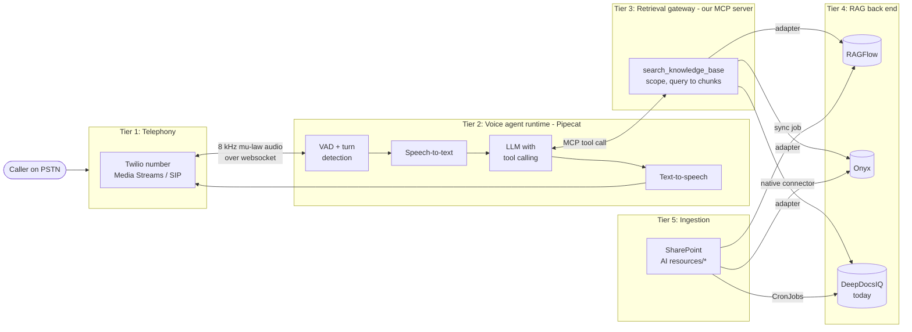

# Open-source voice agent with RAG: layer-by-layer plan

**Status:** exploration draft (2026-10-21). Nothing here has been built or benchmarked yet.
**Goal:** a self-hosted alternative to Synthflow. A caller phones a number, a voice agent answers, and the agent bases its answers on Thryv documents retrieved from RAGFlow or Onyx (or from DeepDocsIQ, which is what runs today).

**Naming:** "Tier 1-5" here means the parts of the architecture. These are not this repo's
test Layers 0-5 (see CLAUDE.md). Where the doc means a test layer, it says "test Layer N".

> Library APIs in the code sketches (Pipecat, RAGFlow, Onyx) change often between releases.
> Treat every snippet as a shape to copy, not as code to paste. Check each one against the
> version you actually install.

---

## 1. The whole picture



**The one design decision that matters most:** the agent never talks to RAGFlow or Onyx
directly. It calls **Tier 3**, a small MCP server we own. That server exposes a fixed tool
contract and has one adapter per back end. Swapping RAGFlow for Onyx (or back to
DeepDocsIQ) then becomes a config change. It doesn't touch the prompt or the agent, and it
doesn't invalidate the tests.

| # | Tier | Recommended pick | Alternative | Owned by us? |
|---|---|---|---|---|
| 1 | Telephony | Twilio Programmable Voice + Media Streams | Telnyx; LiveKit SIP + SIP trunk | No (vendor) |
| 2 | Voice agent runtime | **Pipecat** | LiveKit Agents | Config + glue code |
| 2a | Speech-to-text | Deepgram (streaming) | faster-whisper (self-hosted) | No |
| 2b | LLM | Claude / GPT with tool calling | Llama/Qwen via vLLM | Prompt only |
| 2c | Text-to-speech | Cartesia or ElevenLabs | Kokoro / Piper (self-hosted) | No |
| 2d | VAD / turn-taking | Silero VAD + smart-turn model | | Config |
| 3 | Retrieval gateway | **FastMCP server (new, small)** | | **Yes** |
| 4 | RAG back end | **RAGFlow** or **Onyx** (bake-off) | DeepDocsIQ (as-is) | Deploy + config |
| 5 | Ingestion | Onyx connector / RAGFlow sync job | | Partly |

---

## 2. Tier 1: Telephony (Twilio)

**Job:** own the phone number, answer the call, stream audio both ways, and carry out
transfers and hangups.

**How it connects:** when a call comes in, Twilio fetches TwiML from our webhook. The TwiML
tells Twilio to open a bidirectional Media Stream to our websocket. Audio arrives as
8 kHz mu-law, base64-encoded, in JSON frames.

```xml
<!-- Returned by POST /voice/incoming -->
<Response>
  <Connect>
    <Stream url="wss://voice-agent-qa.example.thryv.com/ws">
      <Parameter name="env" value="qa"/>
    </Stream>
  </Connect>
</Response>
```

```python
# telephony/webhook.py: the TwiML endpoint (FastAPI)
from fastapi import FastAPI, Request
from fastapi.responses import Response

app = FastAPI()

@app.post("/voice/incoming")
async def incoming(request: Request) -> Response:
    form = await request.form()
    # TODO: validate X-Twilio-Signature before trusting the request
    twiml = f"""<Response><Connect>
      <Stream url="wss://{request.url.hostname}/ws">
        <Parameter name="call_sid" value="{form['CallSid']}"/>
      </Stream></Connect></Response>"""
    return Response(content=twiml, media_type="application/xml")
```

**Warm transfer to a human.** This is the part Synthflow currently does for us, and the
part with the most product risk (BUSREQ-14619). The agent calls a `transfer_to_human`
tool. The tool uses the Twilio REST API to move the call into a `<Conference>`, dial the
agent queue into it, and then leave.

```python
# tools/transfer.py: sketch only
from twilio.rest import Client

def transfer_to_human(call_sid: str, queue_number: str, summary: str) -> None:
    client = Client()  # TWILIO_ACCOUNT_SID / TWILIO_AUTH_TOKEN from env
    conf = f"xfer-{call_sid}"
    client.calls(call_sid).update(
        twiml=f"<Response><Dial><Conference>{conf}</Conference></Dial></Response>"
    )
    client.conferences  # then dial the human leg into `conf`,
    # whispering `summary` to them before bridging (warm transfer)
```

**Decisions to make:**
- Media Streams (we run speech-to-text and text-to-speech) or **ConversationRelay**
  (Twilio runs them and we only supply text over a websocket). ConversationRelay is less
  code but gives us less control over latency and interruptions.
- Whether we need recordings, and where they're stored (PII and retention policy).

---

## 3. Tier 2: Voice agent runtime (Pipecat)

**Job:** run the real-time loop. Audio goes in, voice activity detection decides when the
caller has finished their turn, speech-to-text produces text, the LLM replies (possibly
calling tools), text-to-speech produces audio, and audio goes out. Barge-in must work: if
the caller talks over the agent, playback stops.

```text
transport.input()
  -> STT (Deepgram)
  -> user context aggregator
  -> LLM (with MCP tools from Tier 3)
  -> TTS (Cartesia)
  -> transport.output()
  -> assistant context aggregator
```

```python
# agent/bot.py: Pipecat pipeline sketch. Check class names against your pipecat version.
import os
from fastapi import FastAPI, WebSocket

from pipecat.audio.vad.silero import SileroVADAnalyzer
from pipecat.pipeline.pipeline import Pipeline
from pipecat.pipeline.runner import PipelineRunner
from pipecat.pipeline.task import PipelineParams, PipelineTask
from pipecat.processors.aggregators.openai_llm_context import OpenAILLMContext
from pipecat.serializers.twilio import TwilioFrameSerializer
from pipecat.services.anthropic.llm import AnthropicLLMService
from pipecat.services.cartesia.tts import CartesiaTTSService
from pipecat.services.deepgram.stt import DeepgramSTTService
from pipecat.services.mcp_service import MCPClient
from pipecat.transports.network.fastapi_websocket import (
    FastAPIWebsocketParams,
    FastAPIWebsocketTransport,
)

from agent.prompt import SYSTEM_PROMPT

app = FastAPI()


@app.websocket("/ws")
async def ws(websocket: WebSocket):
    await websocket.accept()
    stream_sid, call_sid = await read_twilio_start_frame(websocket)  # helper, not shown

    transport = FastAPIWebsocketTransport(
        websocket=websocket,
        params=FastAPIWebsocketParams(
            audio_in_enabled=True,
            audio_out_enabled=True,
            add_wav_header=False,
            vad_analyzer=SileroVADAnalyzer(),
            serializer=TwilioFrameSerializer(stream_sid, call_sid),
        ),
    )

    stt = DeepgramSTTService(api_key=os.environ["DEEPGRAM_API_KEY"])
    tts = CartesiaTTSService(api_key=os.environ["CARTESIA_API_KEY"],
                             voice_id=os.environ["CARTESIA_VOICE_ID"])
    llm = AnthropicLLMService(api_key=os.environ["ANTHROPIC_API_KEY"],
                              model="claude-sonnet-5-5")

    # Tier 3: tools come from our retrieval gateway over MCP
    mcp = MCPClient(server_params=retrieval_gateway_params())  # URL + auth headers
    tools = await mcp.register_tools(llm)

    context = OpenAILLMContext(
        messages=[{"role": "system", "content": SYSTEM_PROMPT}], tools=tools
    )
    agg = llm.create_context_aggregator(context)

    pipeline = Pipeline([
        transport.input(), stt, agg.user(), llm, tts,
        transport.output(), agg.assistant(),
    ])
    task = PipelineTask(pipeline, params=PipelineParams(
        audio_in_sample_rate=8000, audio_out_sample_rate=8000,
        allow_interruptions=True, enable_metrics=True,
    ))
    await PipelineRunner().run(task)
```

**Sub-layer choices**

| Sub-layer | Start with | Why | Self-hosted option |
|---|---|---|---|
| Speech-to-text | Deepgram streaming | Low latency on 8 kHz phone audio, endpointing built in | faster-whisper on a GPU (higher latency, no per-minute cost) |
| LLM | Claude Sonnet / Haiku | Reliable tool calling; keeps parity with what we test today | Qwen / Llama via vLLM |
| Text-to-speech | Cartesia | Fast time to first audio byte | Kokoro, Piper |
| Turn-taking | Silero VAD + smart-turn | Stops the agent cutting callers off mid-sentence | |

**Latency budget per turn.** The target is under about 1.5 s from when the caller stops
talking to the first audio we play.

| Step | Budget |
|---|---|
| End-of-turn detection | 200-300 ms |
| Speech-to-text final transcript | 100-200 ms |
| LLM first token (no tool call) | 300-500 ms |
| **Tool call: retrieval (Tier 3 + 4)** | **300-800 ms** (embed + hybrid search) |
| LLM first token after tool result | 300-500 ms |
| Text-to-speech first audio | 100-200 ms |

Turns that call retrieval blow the budget, so the agent should say a short filler line
("Let me check that for you...") as it issues the tool call. Pipecat can emit this from
a function-call-started event. Record the per-stage metrics on every call
(`enable_metrics=True`). Being able to see this is the main thing Synthflow doesn't give
us: the 12-16 s silent turns we've seen in test Layer 4 couldn't be broken down by stage.

---

## 4. Tier 3: Retrieval gateway (our MCP server)

**Job:** offer the agent one stable tool contract, whatever back end sits behind it.

**The contract.** It keeps DeepDocsIQ's current response shape so existing prompts and
tests carry over:

```text
tool: search_knowledge_base(query: str, scope: "int_usa" | "int_aus" | "int_nz" |
                                   "int_global" | "pub_usa" | "pub_aus" | "pub_nz" |
                                   "pub_global" | "all") -> list[Chunk]

Chunk = { content: str,
          metadata: { source: str, page: int | null, url: str, folder: str, score: float } }

errors -> MCP tool error (isError: true), NOT a 200 with [{"error": ...}]
```

The last line deliberately differs from DeepDocsIQ. Today a search failure comes back as a
normal-looking result, so the agent can confidently answer "I couldn't find anything"
during an outage.

**One tool with a `scope` argument, or nine tools?** DeepDocsIQ exposes nine tools today.
One tool with an enum argument is easier for the LLM to choose correctly, and easier to
test. The scope can also be fixed by the server according to which number was called (an
AU number means `*_aus` scopes), instead of being left to the LLM.

```python
# gateway/server.py
import os
from typing import Literal

from fastmcp import FastMCP

from gateway.adapters import get_adapter  # RagflowAdapter | OnyxAdapter | DeepDocsIQAdapter

mcp = FastMCP("Thryv Knowledge Gateway", stateless_http=True)
backend = get_adapter(os.environ["RAG_BACKEND"])  # "ragflow" | "onyx" | "deepdocsiq"

Scope = Literal["int_usa", "int_aus", "int_nz", "int_global",
                "pub_usa", "pub_aus", "pub_nz", "pub_global", "all"]


@mcp.tool
async def search_knowledge_base(query: str, scope: Scope = "all") -> list[dict]:
    """Search Thryv's support knowledge base. Returns source passages, not an answer.
    Use for any question about Thryv products, policies or procedures."""
    chunks = await backend.search(query=query, scope=scope, top_k=8)
    return [c.model_dump() for c in chunks]  # raising here becomes an MCP tool error


if __name__ == "__main__":
    mcp.run(transport="http", host="0.0.0.0", port=8000)
```

```python
# gateway/adapters/base.py
from typing import Protocol

from pydantic import BaseModel


class Chunk(BaseModel):
    content: str
    metadata: dict


class RetrievalAdapter(Protocol):
    async def search(self, query: str, scope: str, top_k: int) -> list[Chunk]: ...
```

**Auth:** the gateway checks a per-client credential. The voice agent gets its own
credential, separate from any human user. The gateway in turn holds the back-end API
keys, so those keys never reach the agent's environment.

---

## 5. Tier 4: RAG back end (RAGFlow or Onyx)

Both are self-hostable with Docker Compose or Helm. **Run a bake-off before choosing.**
Load the same QA SharePoint content into both, then score both against the existing
OOE / Ragas question set (see section 8).

### 5a. RAGFlow adapter

RAGFlow organises content into **datasets**. Map one dataset to each scope
(`int_usa` -> dataset id ...). Its retrieval endpoint returns chunks with similarity
scores and does hybrid search, with a tunable keyword/vector weighting.

```python
# gateway/adapters/ragflow.py: check endpoint and field names against your RAGFlow version
import os

import httpx

from gateway.adapters.base import Chunk

SCOPE_TO_DATASETS = {  # loaded from config in practice
    "int_usa": ["<dataset-id>"],
    "pub_usa": ["<dataset-id>"],
    # ...
}


class RagflowAdapter:
    def __init__(self) -> None:
        self.base = os.environ["RAGFLOW_URL"]
        self.headers = {"Authorization": f"Bearer {os.environ['RAGFLOW_API_KEY']}"}

    async def search(self, query: str, scope: str, top_k: int) -> list[Chunk]:
        ids = sum(SCOPE_TO_DATASETS.values(), []) if scope == "all" else SCOPE_TO_DATASETS[scope]
        async with httpx.AsyncClient(timeout=5.0) as client:
            r = await client.post(f"{self.base}/api/v1/retrieval", headers=self.headers, json={
                "question": query,
                "dataset_ids": ids,
                "top_k": 50,                      # candidate pool (cf. AI-1322)
                "page_size": top_k,               # returned to the agent
                "vector_similarity_weight": 0.5,  # hybrid weighting; tune in the bake-off
                "similarity_threshold": 0.2,
            })
        r.raise_for_status()
        body = r.json()
        if body.get("code") != 0:
            raise RuntimeError(f"RAGFlow retrieval failed: {body.get('message')}")
        return [
            Chunk(content=c["content"], metadata={
                "source": c.get("document_keyword"), "page": None,
                "url": None, "folder": scope, "score": c.get("similarity"),
            })
            for c in body["data"]["chunks"]
        ]
```

- **Strengths:** layout-aware parsing (tables, scanned PDFs), chunk templates that can
  be chosen per dataset, and you can see and edit chunks in its UI.
- **Gap:** SharePoint sync may not be built in (check). If it isn't, Tier 5 needs a sync
  job of our own.

### 5b. Onyx adapter

Onyx organises content into **connectors** and **document sets**. Map one document set to
each scope. Its native SharePoint connector does incremental sync.

```python
# gateway/adapters/onyx.py: Onyx's search endpoint paths have changed between
# releases; find the current document-search API in your version's docs.
import os

import httpx

from gateway.adapters.base import Chunk

SCOPE_TO_DOC_SETS = {"int_usa": ["Internal USA"], "pub_usa": ["Public USA"]}  # ...


class OnyxAdapter:
    def __init__(self) -> None:
        self.base = os.environ["ONYX_URL"]
        self.headers = {"Authorization": f"Bearer {os.environ['ONYX_API_KEY']}"}

    async def search(self, query: str, scope: str, top_k: int) -> list[Chunk]:
        filters = {} if scope == "all" else {"document_set": SCOPE_TO_DOC_SETS[scope]}
        async with httpx.AsyncClient(timeout=5.0) as client:
            r = await client.post(f"{self.base}/api/<document-search-endpoint>",
                                  headers=self.headers,
                                  json={"query": query, "filters": filters, "limit": top_k})
        r.raise_for_status()
        return [
            Chunk(content=d["content"], metadata={
                "source": d.get("semantic_identifier"), "page": None,
                "url": d.get("link"), "folder": scope, "score": d.get("score"),
            })
            for d in r.json()["documents"]
        ]
```

- **Strengths:** built-in SharePoint connector with incremental sync, hybrid search on
  Vespa, an admin UI, and many other connectors (Confluence, Jira, Slack) if the scope
  grows later.
- **Gap:** permission sync at the level of individual documents is an enterprise-edition
  feature. Today's folder-based internal/public split doesn't need it.

### 5c. DeepDocsIQ adapter (baseline)

A thin client that calls the existing `/ask-{scope}-question` routes with the
`Client-Id`/`Client-Secret` headers. Build this one **first**: it lets Tiers 1-3 run end
to end against a back end we already know, and it becomes the baseline the RAGFlow and
Onyx results are compared with.

### Bake-off comparison

| Criterion | How we measure it |
|---|---|
| Retrieval quality | Context recall / precision on the OOE + Ragas question set, including Q38 (AI-1322) |
| Latency | p50 / p95 of `search_knowledge_base` from the gateway, under ~10 concurrent calls |
| Freshness | Edit a SharePoint doc, time until the change is searchable |
| Deletion | Delete a SharePoint doc, confirm it stops appearing in results |
| Scanned / table-heavy PDFs | Hand-pick 10 hard documents, check the extracted chunks |
| Ops cost | Containers, memory, GPU needs, upgrade story on phx1 |

---

## 6. Tier 5: Ingestion from SharePoint

| Back end | Ingestion path |
|---|---|
| Onyx | Native SharePoint connector pointed at `AI resources_{env}/{Internal,Public} Documents/*`. Configured in the admin UI; Onyx tracks what has changed. |
| RAGFlow | If there's no native connector: a CronJob that lists changed items through Microsoft Graph (**delta query**, `/drives/{id}/root/delta`), uploads them to the matching dataset, and triggers parsing. Keep the Graph delta token in **persistent storage** (a PVC or a DB row), not on the container filesystem. That's the suspected DeepDocsIQ bug. |
| DeepDocsIQ | Unchanged (the 9 CronJobs). |

**Requirements, whichever back end wins:**
- Changes appear within a stated time (for example, under 2 hours).
- Deleting a document in SharePoint removes it from search.
- Each run logs files seen / indexed / skipped / failed, so a silent stall is visible.

---

## 7. Deployment (phx1 Kubernetes)

```text
Namespace: voice-agent-{env}
  voice-agent        Deployment  (Tier 1 webhook + Tier 2 websocket), HPA on active calls
  knowledge-gateway  Deployment  (Tier 3), stateless, 2+ replicas
  ragflow | onyx     Helm release (Tier 4) + its own datastores
  sp-sync            CronJob     (Tier 5, RAGFlow only)
Ingress:   public HTTPS + WSS for the Twilio webhook and media stream (Twilio must reach it)
Secrets:   Vault -> Twilio, Deepgram, Cartesia, LLM, RAG back-end keys
```

**Constraints worth checking early:**
- Twilio has to reach the websocket from the internet. That means a public ingress and
  long-lived WSS connections (idle timeouts on nginx and any load balancer).
- Each live call holds one websocket on one pod. The HPA has to scale on concurrent calls,
  not CPU, and scale-down must drain calls instead of cutting them off.

---

## 8. Testing strategy (the main QA win)

Owning the pipeline means the **real** prompt, model and tools can be tested without
phone audio.

| Level | What it exercises | How |
|---|---|---|
| L-A: Retrieval | Tier 3 + 4 | Call `search_knowledge_base` directly with the question set; Ragas context recall/precision; no LLM involved |
| L-B: Agent (text) | Tier 2 LLM + tools + 3 + 4 | Run the Pipecat pipeline with a text transport (no STT/TTS); assert on tool calls made, scope chosen, answer faithfulness |
| L-C: Voice | Full Tier 2 | Pre-recorded caller audio in through a local transport; assert on transcript + timing metrics |
| L-D: Telephony | Tier 1 to 5 end to end | Scripted calls to the QA number (Twilio test call + recorded prompts); check transfer and hangup paths |

L-B **replaces** the current test Layer 3 Haiku stand-in. It runs the production prompt and
model, so the gap between "stand-in passes" and "Poppy fails" goes away.

**Every turn's logs should record:** the speech-to-text transcript, the tool calls with
their arguments and the chunk ids returned, the LLM output, and the latency of each stage.
That log is the evidence behind any defect ticket.

---

## 9. Phased plan

| Phase | Deliverable | Exit criteria |
|---|---|---|
| 0. Spike (about 1 week) | Pipecat + Twilio on a laptop through ngrok, DeepDocsIQ adapter, one QA number | A real call answers a known OOE question from a correct chunk |
| 1. Gateway | Tier 3 with the DeepDocsIQ adapter, MCP tool errors, logs per turn | L-A and L-B suites run in CI |
| 2. Bake-off | RAGFlow and Onyx on phx1 QA, same SharePoint content, both adapters | Section 5 comparison table filled in; back end chosen |
| 3. Parity | Warm transfer, recordings, voicemail detection, filler speech | Transfer scenarios from BUSREQ-14619 pass at L-D |
| 4. Shadow | Run alongside Synthflow on a subset of test numbers | Latency p95 and answer quality at or better than Synthflow |

---

## 10. Open questions

- Who owns this operationally once it's live (on-call, Twilio account, model spend)?
- Do non-engineers need a UI for editing prompts? If so, where does the prompt live: a
  file in git, the gateway, or a small admin app?
- Recording, transcript and PII retention rules for calls handled entirely by our own
  stack.
- Per-minute cost comparison: Synthflow vs Twilio + speech-to-text + text-to-speech + LLM
  + hosting.
- Does any caller-facing flow need document permissions beyond the internal/public folder
  split?
